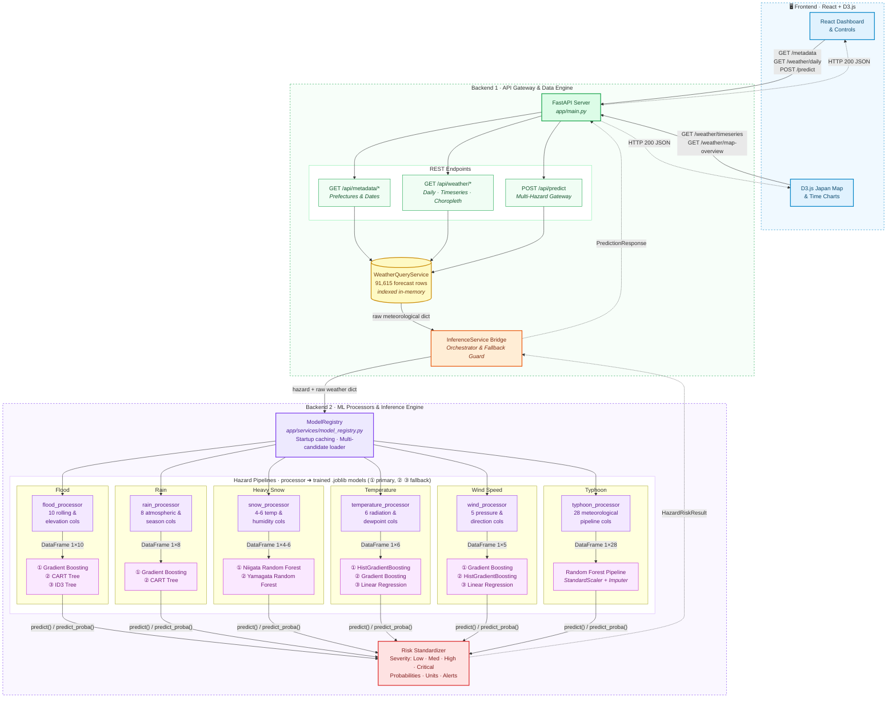

# Japan Disaster & Weather Intelligence System
## Backend Architecture, ML Inference Pipeline & Backend 2 Developer Handoff Guide

> **Repository:** [j23040579/Innovation-A3](https://github.com/j23040579/Innovation-A3)  
> **Server Base URL:** `http://localhost:8000`  
> **Interactive Swagger Documentation:** `http://localhost:8000/docs`  
> **Alternative Redoc Documentation:** `http://localhost:8000/redoc`  
> **Automated Test Suite:** `python backend/test_backend.py`

---

## 1. System Overview & Division of Responsibilities

The system is partitioned into two backend halves and two frontend halves:

```text
┌────────────────────────────────────────────────────────────────────────┐
│                          FRONTEND (2 People)                           │
│  [FE 1: React UI & State Controls]  <──>  [FE 2: D3.js Maps & Charts]  │
└───────────────────────────────────┬────────────────────────────────────┘
                                    │ HTTP REST API (JSON)
┌───────────────────────────────────┴────────────────────────────────────┐
│                       BACKEND 1: COMPLETED  (Ian)                      │
│   • FastAPI Server, Lifespan Startup, CORS Middleware, Error Handling  │
│   • 91,615-Row Pre-generated Future Dataset In-Memory Query Engine     │
│   • Time-Series Slicing (for D3) & Map Overviews (for Choropleth)      │
│   • Disaster Prediction API Gateway & Fallback Safe Mock Engine        │
└───────────────────────────────────┬────────────────────────────────────┘
                                    │ Structured Weather Features (dict)
┌───────────────────────────────────┴────────────────────────────────────┐
│                  BACKEND 2: (charlie)                                  │
│   • Preprocessor Dispatcher (backend/app/processors/*.py)              │ 
│   • Real-Time Model Inference (.predict() & .predict_proba())          │
│   • Hazard Probability & Risk Category Standardizer                    │
└────────────────────────────────────────────────────────────────────────┘
```

---

## 2. Mermaid Backend Architecture & Request Flow



---


## 3. Directory Structure

```text
backend/
├── app/
│   ├── main.py                           [B1] FastAPI app instance, CORS & lifespan startup
│   ├── core/
│   │   ├── config.py                     [B1] Project settings, directory roots, CORS origins
│   ├── schemas/
│   │   ├── weather.py                    [B1] Pydantic models for raw weather & D3 time series
│   │   └── prediction.py                 [B1] Pydantic models for disaster prediction
│   ├── api/
│   │   ├── routes_metadata.py            [B1] /api/metadata endpoints (prefectures, dates)
│   │   ├── routes_weather.py             [B1] /api/weather endpoints (daily, timeseries, map-overview)
│   │   └── routes_predict.py             [B1] /api/predict disaster gateway
│   ├── services/
│   │   ├── weather_query_service.py       [B1] Fast in-memory query engine (91,615 rows indexed)
│   │   ├── inference_service.py          [B1] Bridge between API and Backend 2 ModelRegistry
│   │   └── model_registry.py            x [B2] Multi-candidate Joblib loader & inference engine
│   └── processors/                      x [B2] Feature extraction & transformer modules
│       ├── base_processor.py             [B1] Abstract base class contract
│       ├── flood_processor.py           x [B2] Flood feature extraction & DataFrame formatting
│       ├── rain_processor.py            x [B2] Rain feature extraction & DataFrame formatting
│       ├── snow_processor.py            x [B2] Snow feature extraction & DataFrame formatting
│       ├── temperature_processor.py     x [B2] Temperature feature extraction & DataFrame formatting
│       ├── typhoon_processor.py         x [B2] Typhoon 28-feature DataFrame transformer
│       └── wind_processor.py            x [B2] Wind speed feature extraction & DataFrame formatting
├── run.py                                [B1] Server launch script (python backend/run.py)
├── test_backend.py                       [B1] Automated 7-point API verification suite
├── requirements.txt                      [B1] Dependencies list
└── HANDOFF_AND_ARCHITECTURE.md           [B1 & B2] This documentation file
```

---

## 4. Hazard Models, Features & Fallback Hierarchy

| Hazard | Target Type | Primary Model | Fallback Models | Features Count | Processor Module |
| :--- | :--- | :--- | :--- | :--- | :--- |
| **Flood** | Classification (`Low`, `Medium`, `High`) | `gradient_boosting_flood.joblib` | `cart_flood.joblib`, `id3_flood.joblib` | 10 | `app.processors.flood_processor` |
| **Rain** | Classification (`No/Minimal Rain`, `Low`, `Moderate`, `High`) | `gradient_boosting.joblib` | `cart.joblib` | 8 | `app.processors.rain_processor` |
| **Heavy Snow** | Classification (`0: Low`, `1: Medium`, `2: High`) | `niigata/random_forest.joblib` | `yamagata/random_forest.joblib` | 4 | `app.processors.snow_processor` |
| **Temperature** | Regression (`temperature_2m_max` in °C) | `hist_gradient_boosting_temp_max.joblib` | `gradient_boosting_temp_max.joblib`, `linear_regression_temp_max.joblib` | 6 | `app.processors.temperature_processor` |
| **Wind Speed** | Regression (`wind_speed_10m_max` in km/h) | `gradient_boosting.joblib` | `hist_gradient_boosting.joblib`, `multiple_linear_regression.joblib` | 5 | `app.processors.wind_processor` |
| **Typhoon** | Profile (`Low`, `Medium`, `High`) | `final_test2/random_forest_model.joblib` | Pipeline with `StandardScaler` & Imputer | 28 | `app.processors.typhoon_processor` |

---

### Detailed Feature Specifications

#### 🌊 1. Flood
* **Features (in exact order):**
  1. `rain_sum_past_3day`
  2. `rain_sum_past_7day`
  3. `max_daily_rain_past_7day`
  4. `precipitation_hours_past_7day`
  5. `river_discharge_previous_day`
  6. `river_discharge_mean_7day`
  7. `river_discharge_median_7day`
  8. `river_discharge_max_7day`
  9. `discharge_ratio`
  10. `elevation`
* **Risk Rule:** Class prediction (`str(pred)`). Trigger alert if `"High"`.

#### 🌧️ 2. Rain
* **Features (in exact order):**
  1. `temperature_2m_max`
  2. `relative_humidity_2m_mean`
  3. `dew_point_2m_mean`
  4. `cloud_cover_mean`
  5. `pressure_msl_mean`
  6. `wind_speed_10m_max`
  7. `shortwave_radiation_sum`
  8. `month` (integer 1–12)
* **Risk Rule:** Class prediction (`str(pred)`). `threshold_exceeded` is true if not `"No/Minimal Rain"`.

#### ❄️ 3. Heavy Snow
* **Features:**
  1. `max_temperature`
  2. `min_temperature`
  3. `max_humidity`
  4. `min_humidity`
* **Risk Rule:** Class mapping `{0: "Low", 1: "Medium", 2: "High"}`.

#### 🌡️ 4. Temperature (Regression)
* **Features (in exact order):**
  1. `shortwave_radiation_sum`
  2. `sunshine_duration`
  3. `daylight_duration`
  4. `cloud_cover_mean`
  5. `dew_point_2m_mean`
  6. `month` (integer 1–12)
* **Risk Categorization Rules:**
  * `< 28°C` → `Low`
  * `28°C – 33°C` → `Medium`
  * `33°C – 36°C` → `High` (Heat Advisory)
  * `≥ 36°C` → `Critical` (Heat Stroke Warning)

#### 💨 5. Wind Speed (Regression)
* **Features (in exact order):**
  1. `surface_pressure_mean`
  2. `surface_pressure_max`
  3. `surface_pressure_min`
  4. `pressure_change`
  5. `wind_direction_10m_dominant`
* **Risk Categorization Rules:**
  * `< 35 km/h` → `Low`
  * `35 – 50 km/h` → `Medium`
  * `50 – 65 km/h` → `High` (Gale Warning)
  * `> 65 km/h` → `Critical` (Severe Storm)

#### 🌀 6. Typhoon
* **Features:** 28 meteorological attributes passed as a 1-row `pandas.DataFrame`. The saved scikit-learn Pipeline internally handles `StandardScaler`, `SimpleImputer`, and wind trigonometry.

---

## 5. How to Retrain Models (If Scikit-Learn is Updated)

If dependencies change or you need to retrain models, use the standalone scripts from the repository root:

```bash
# Retrain Flood Models (GBDT, CART, ID3)
python Flood/train_flood_models.py

# Retrain Rain Models (GBDT, CART)
python Rain/train_rain_models.py

# Retrain Wind Models (Linear Regression, GBDT, HistGradientBoosting)
python Wind/train_wind_models.py
```

The scripts will:
1. Split the historical dataset chronologically (80% train / 20% test).
2. Train all candidate models.
3. Save compatible `.joblib` files to their respective `trained_models/` directories.
4. Record metrics in `experiment_logs/final_test/`.

---

## 6. How to Verify Everything (Backend 2 Test Suite)

Whenever any model, processor, or fallback is updated, run:

```bash
python backend/test_backend.py
```

**What to look for in the output:**
1. Model loading logs:
   ```text
   Loaded Flood model: 'Gradient Boosting (Flood Classifier)' from gradient_boosting_flood.joblib
   Loaded Rain model: 'Gradient Boosting (Rain Classifier)' from gradient_boosting.joblib
   Loaded Snow model: 'Random Forest Classifier (Snow)' from random_forest.joblib
   Loaded Temperature model: 'HistGradientBoosting Regressor (Temperature)' from hist_gradient_boosting_temp_max.joblib
   Loaded Wind model: 'Gradient Boosting Regressor (Wind)' from gradient_boosting.joblib
   Loaded Typhoon model: 'Random Forest Pipeline (Typhoon)' from random_forest_model.joblib
   ModelRegistry initialized with 6 active models.
   ```
2. Test 7 output:
   ```text
   [7/7] Testing POST /api/predict ...
     Passed! Mode: 'inference', Overall Risk: 'High'
   ```
   > **Note:** If `Mode: 'inference'` is displayed, the live machine learning models generated the response. If `Mode: 'mock'` appears, check the logs for a missing column or path.

---

## 7. Frontend Developer Guide (React & D3.js)

### Base Information
* **Base URL:** `http://localhost:8000`
* **CORS:** Accepts all localhost ports (`5173`, `3000`, `4173`, etc.)
* **Date Limits:** Future forecast covers **`2026-02-01` to `2027-01-31`** (365 days).

### Endpoints Reference

#### 📍 1. Get All Prefectures & Towns
* **Method:** `GET`
* **Path:** `/api/metadata/prefectures`
* **Response Sample:**
```json
{
  "count": 59,
  "prefectures": [
    {
      "prefecture": "Tokyo",
      "towns": ["Hachioji", "Machida", "Ome", "Shinjuku", "Tachikawa"]
    }
  ]
}
```

#### 📅 2. Get Valid Date Bounds
* **Method:** `GET`
* **Path:** `/api/metadata/date-range`
* **Response Sample:**
```json
{
  "min_date": "2026-02-01",
  "max_date": "2027-01-31",
  "total_days": 365
}
```

#### 🗺️ 3. Get Map Overview (D3 Choropleth Map)
* **Method:** `GET`
* **Path:** `/api/weather/map-overview?date=2026-06-15`
* **Response Sample:**
```json
{
  "date": "2026-06-15",
  "count": 59,
  "items": [
    {
      "prefecture": "Tokyo",
      "date": "2026-06-15",
      "latitude": 35.69,
      "longitude": 139.69,
      "temperature_mean": 21.4,
      "rain_sum": 5.57,
      "snowfall_sum": 0.0,
      "wind_speed_max": 21.4,
      "primary_risk_level": "Low"
    }
  ]
}
```

#### 📈 4. Get Time-Series Forecast (D3 Charts)
* **Method:** `GET`
* **Path:** `/api/weather/timeseries?prefecture=Tokyo&start_date=2026-06-01&end_date=2026-06-10`
* **Response Sample:**
```json
{
  "prefecture": "Tokyo",
  "town": null,
  "start_date": "2026-06-01",
  "end_date": "2026-06-10",
  "total_data_points": 10,
  "series": [
    {
      "date": "2026-06-01",
      "temperature_max": 24.3,
      "temperature_min": 16.1,
      "temperature_mean": 20.2,
      "rain_sum": 0.0,
      "precipitation_sum": 0.0,
      "wind_speed_max": 18.2,
      "wind_gusts_max": 29.5,
      "relative_humidity_mean": 65.4,
      "surface_pressure_mean": 1012.3,
      "cloud_cover_mean": 42.1,
      "river_discharge": 1.2
    }
  ]
}
```

#### ⚠️ 5. Predict Disaster Risks (Main Prediction Gateway)
* **Method:** `POST`
* **Path:** `/api/predict`
* **Request Body:**
```json
{
  "prefecture": "Tokyo",
  "date": "2026-06-15",
  "town": "Shinjuku",
  "hazards": ["flood", "rain", "temperature", "typhoon", "wind", "snow"]
}
```
* **Response Sample:**
```json
{
  "prefecture": "Tokyo",
  "town": "Shinjuku",
  "date": "2026-06-15",
  "overall_risk_level": "High",
  "weather_summary": {
    "temperature_max": 25.5,
    "temperature_min": 17.2,
    "rain_sum_mm": 5.6,
    "snowfall_sum_cm": 0.0,
    "wind_speed_max_kmh": 21.4,
    "relative_humidity_pct": 74.2,
    "surface_pressure_hpa": 1008.5,
    "river_discharge": 2.1
  },
  "risks": [
    {
      "hazard": "flood",
      "model_name": "Gradient Boosting (Flood Classifier)",
      "risk_level": "Low",
      "probability": 1.0,
      "unit": "class",
      "threshold_exceeded": false,
      "alert_message": "Normal river conditions",
      "contributing_factors": {
        "elevation": 40.0
      }
    },
    {
      "hazard": "rain",
      "model_name": "Gradient Boosting (Rain Classifier)",
      "risk_level": "No/Minimal Rain",
      "probability": 0.703,
      "unit": "class",
      "threshold_exceeded": false,
      "alert_message": "Clear weather expected"
    },
    {
      "hazard": "wind",
      "model_name": "Gradient Boosting Regressor (Wind)",
      "risk_level": "Low",
      "predicted_value": 13.5,
      "unit": "km/h",
      "threshold_exceeded": false,
      "alert_message": "Wind conditions normal"
    }
  ],
  "execution_mode": "inference"
}
```

---

## 8. Launching the Backend Server

```bash
# 1. Install dependencies
pip install -r backend/requirements.txt

# 2. Run the server
python backend/run.py
```

* API will be available at: `http://localhost:8000`
* Swagger docs: `http://localhost:8000/docs`


