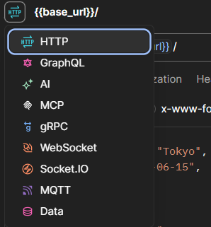
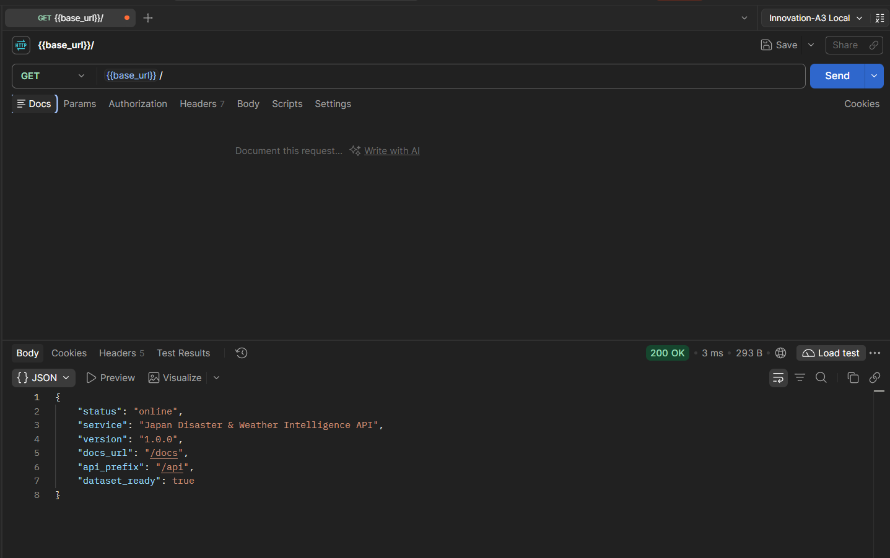
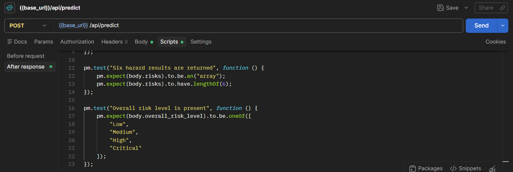

# Backend Testing Guide

This guide explains how to test the Japan Disaster & Weather Intelligence
System backend locally using the automated verification suite and Postman.

## 1. What is the automated verification suite?

The automated verification suite is the Python file:

```text
backend\test_backend.py
```

It uses FastAPI's test client to start the application temporarily and
automatically check the main backend features:

1. `GET /` service health check
2. `GET /api/metadata/prefectures` prefecture metadata
3. `GET /api/metadata/date-range` valid forecast dates
4. `GET /api/weather/daily` single-day weather data
5. `GET /api/weather/timeseries` time-series weather data
6. `GET /api/weather/map-overview` map summary data
7. `POST /api/predict` multi-hazard machine-learning predictions

It is an end-to-end test: it checks more than individual functions. It
confirms that the API starts, the forecast dataset loads, the routes respond,
the model files can be loaded, and the prediction response has the expected
structure.

## 2. Why should teammates run it?

Every teammate should run the suite after cloning or pulling the repository
because it quickly verifies that their local environment is working. It can
identify:

- missing Python packages;
- an incorrect working directory;
- missing forecast data;
- missing or unloadable model files;
- broken API routes;
- invalid prediction responses; and
- a backend that silently falls back to mock predictions.

A successful run should finish with:

```text
ALL 7 API VERIFICATION TESTS PASSED SUCCESSFULLY!
```

The seventh test should also include:

```text
Passed! Mode: 'inference'
```

## 3. What does `inference` mean?

`inference` means the backend used the saved machine-learning models to
calculate predictions from the requested weather data.

The backend can also operate in `mock` mode. Mock mode returns placeholder
rule-based results so frontend development can continue when the trained
models are unavailable. Mock mode is useful as a fallback, but it does not
prove that the real ML models are working.

For normal backend testing, the expected result is:

```text
Mode: 'inference'
```

If the result says `mock`, check the troubleshooting section below.

## 4. Prerequisites

Install the following:

- Git
- Python 3.10 or newer
- Postman Desktop or Postman web with the Desktop Agent

The commands in this guide use Windows PowerShell.

## 5. Clone or update the repository

Clone the repository:

```powershell
git clone https://github.com/j23040579/Innovation-A3.git
Set-Location Innovation-A3
```

If the repository is already cloned:

```powershell
Set-Location Innovation-A3
git pull
```

All commands must be run from the repository root. The root is the folder
containing:

```text
backend
Flood
Rain
Temperature
Typhoon
Wind
Heavy Snow
```

## 6. Install Python dependencies

From the repository root, run:

```powershell
python -m pip install -r backend\requirements.txt
```

Confirm that Python is available:

```powershell
python --version
```

## 7. Run the automated verification suite

From the repository root, run:

```powershell
python backend\test_backend.py
```

The final output should include:

```text
[7/7] Testing POST /api/predict ...
  Passed! Mode: 'inference', Overall Risk: 'High'

ALL 7 API VERIFICATION TESTS PASSED SUCCESSFULLY!
```

The exact risk level may differ and its not important. The
important checks are that all seven tests pass and that the execution mode is
`inference`.

The automated suite starts and stops its own temporary test application. It
does not leave the API server running.

## 8. Start the backend server for Postman

Open a new PowerShell window and go to the repository root:

```powershell
Set-Location Innovation-A3
python backend\run.py
```

Keep this PowerShell window open while testing with Postman. The API base URL
is:

```text
http://localhost:8000
```

The server is stopped by pressing `Ctrl+C` in the server window.

## 9. Create a Postman environment

In Postman:

1. Select **Environments**. (Top right)
2. Create an environment named `Innovation-A3 Local`.
3. Add this variable:

| Variable | value | 
|---|---|
| `base_url` | `http://localhost:8000` | 

4. Save the environment.
5. Select `Innovation-A3 Local` in the environment selector.

Requests can now use:

```text
{{base_url}}
```
6. Make sure you are selecting the environment in the drop down.
7. Close environment tab.
## 10. Postman requests

For each request:

1. Create a new request.
2. Select the HTTP method.
<br>

3. Enter the URL.
4. Click **Send**.
5. Check the status code and response body.
<br>


### 10.1 Service health

**Method:** `GET`

**URL:**

```text
{{base_url}}/
```

Expected status: `200 OK`

Important response fields:

```json
{
  "status": "online",
  "dataset_ready": true
}
```

### 10.2 Backend health and dataset status

**Method:** `GET`

**URL:**

```text
{{base_url}}/api/health
```

Expected status: `200 OK`

Important response fields:

```json
{
  "status": "healthy",
  "dataset_loaded": true,
  "prefectures_count": 59
}
```

### 10.3 List prefectures and towns

**Method:** `GET`

**URL:**

```text
{{base_url}}/api/metadata/prefectures
```

Expected status: `200 OK`

The response contains a `count` and a `prefectures` array.

### 10.4 Check the valid forecast date range

**Method:** `GET`

**URL:**

```text
{{base_url}}/api/metadata/date-range
```

Expected status: `200 OK`

The current forecast dataset covers dates within:

```text
2026-02-01 to 2027-01-31
```

### 10.5 Get daily weather

**Method:** `GET`

**URL:**

```text
{{base_url}}/api/weather/daily?prefecture=Tokyo&date=2026-06-15
```

Expected status: `200 OK`

The response should contain weather metrics such as maximum temperature,
rainfall, wind speed, humidity, pressure, and snowfall.

To request a specific town, add the `town` query parameter:

```text
{{base_url}}/api/weather/daily?prefecture=Tokyo&date=2026-06-15&town=Shinjuku
```

### 10.6 Get a weather time series

**Method:** `GET`

**URL:**

```text
{{base_url}}/api/weather/timeseries?prefecture=Tokyo&start_date=2026-06-01&end_date=2026-06-10
```

Expected status: `200 OK`

The response should contain:

- `total_data_points`;
- a `series` array; and
- one weather record for each available date.

### 10.7 Get map overview data

**Method:** `GET`

**URL:**

```text
{{base_url}}/api/weather/map-overview?date=2026-06-15
```

Expected status: `200 OK`

The response should contain one summary item per available prefecture, with
coordinates and summary weather values.

### 10.8 Run all six hazard predictions

**Method:** `POST`

**URL:**

```text
{{base_url}}/api/predict
```

In Postman, select **Body**, choose **raw**, select **JSON**, and enter:

```json
{
  "prefecture": "Tokyo",
  "date": "2026-06-15",
  "hazards": [
    "flood",
    "rain",
    "temperature",
    "typhoon",
    "wind",
    "snow"
  ]
}
```

Expected status: `200 OK`

The response should contain:

- `prefecture`;
- `date`;
- `overall_risk_level`;
- `weather_summary`;
- six entries in `risks`; and
- `"execution_mode": "inference"`.

Each risk result may include:

- `hazard`;
- `model_name`;
- `risk_level`;
- `probability` for classification models;
- `predicted_value` for regression models;
- `unit`;
- `threshold_exceeded`; and
- `alert_message`.

### 10.9 Run one hazard only

The API also accepts a smaller hazard list. For example:

```json
{
  "prefecture": "Tokyo",
  "date": "2026-06-15",
  "hazards": [
    "temperature"
  ]
}
```

This is useful when testing a single model.

Supported hazard identifiers are:

```text
flood
rain
snow
temperature
typhoon
wind
```

## 11. Optional Postman test scripts

Postman can automatically check response conditions.
<br>


Open the **Scripts** tab > "After Response" for the `POST {{base_url}}/api/predict` request and add:

```javascript
pm.test("Response status is 200", function () {
    pm.response.to.have.status(200);
});

const body = pm.response.json();

pm.test("Execution mode is inference", function () {
    pm.expect(body.execution_mode).to.eql("inference");
});

pm.test("Six hazard results are returned", function () {
    pm.expect(body.risks).to.be.an("array");
    pm.expect(body.risks).to.have.lengthOf(6);
});

pm.test("Overall risk level is present", function () {
    pm.expect(body.overall_risk_level).to.be.oneOf([
        "Low",
        "Medium",
        "High",
        "Critical"
    ]);
});
```

Click **Send** again and open the **Test Results** section to see the
automated Postman assertions.

## 12. PowerShell alternative for the prediction request (optional)

Postman is the recommended manual API tool, but this command is useful for
quick troubleshooting:

```powershell
Invoke-RestMethod `
  -Method Post `
  -Uri http://localhost:8000/api/predict `
  -ContentType "application/json" `
  -Body '{"prefecture":"Tokyo","date":"2026-06-15","hazards":["flood","rain","temperature","typhoon","wind","snow"]}'
```

## 13. Troubleshooting

### if `python` is not recognized

Install Python and enable **Add Python to PATH** during installation. Restart
PowerShell and run:

```powershell
python --version
```

### `ModuleNotFoundError`

Install the backend dependencies again from the repository root:

```powershell
python -m pip install -r backend\requirements.txt
```

### The server cannot find the dataset

Confirm that the command is being run from the repository root and that the
`Future Weather Attributes` directory exists.

### `Mode: 'mock'`

This means the live ML registry was not connected. Check that the model
directories and `.joblib` files exist:

```text
Flood\trained_models
Rain\trained_models
Heavy Snow\trained_models
Temperature\trained_models
Wind\trained_models
Typhoon\trained_models
```

Run the automated suite again and inspect the startup logs for model-loading
errors.

### `Connection refused` in Postman

The API server is not running or is using a different port. Start it with:

```powershell
python backend\run.py
```

Then confirm that Postman uses:

```text
http://localhost:8000
```

### Port 8000 is already in use

Stop the existing process using port 8000, or start the backend on another
port:

```powershell
$env:API_PORT = "8001"
python backend\run.py
```

Then change the Postman `base_url` variable to:

```text
http://localhost:8001
```

### `404` from a weather or prediction request

Check that:

- the prefecture spelling is correct;
- the date is within the forecast range;
- the URL uses the correct path; and
- query parameters are spelled correctly.

Use `Tokyo` and `2026-06-15` as the known-good example values.

### scikit-learn `InconsistentVersionWarning`

The saved models were created with a different scikit-learn patch version.
This warning is non-fatal if the application starts, all models load, and the
automated suite finishes with:

```text
ALL 7 API VERIFICATION TESTS PASSED SUCCESSFULLY!
```

## 14. Recommended teammate test order

Use this order when reporting test results:

1. Run `python backend\test_backend.py`.
2. Confirm all seven automated tests pass.
3. Confirm Test 7 reports `Mode: 'inference'`.
4. Start the server with `python backend\run.py`.
5. Run `GET {{base_url}}/api/health` in Postman.
6. Run `GET {{base_url}}/api/weather/daily?prefecture=Tokyo&date=2026-06-15`.
7. Run `POST {{base_url}}/api/predict` with all six hazards.
8. Record any errors, response status codes, and whether the execution mode
   was `inference` or `mock`.
